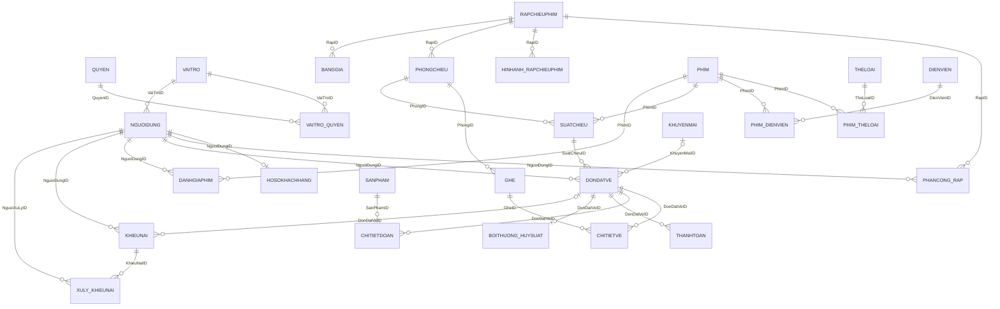

# Lược đồ quan hệ CinemaBookingDB

Đối chiếu source hiện tại ngày 13/10/2026: **27 bảng**, **31 khóa ngoại**, tất cả thuộc schema `dbo`.

Nguồn: [định nghĩa bảng](02_tables/), [PK và UNIQUE](03_constraints/001_primary_unique.sql), [khóa ngoại](03_constraints/002_foreign_keys.sql), [bảng bồi thường](02_tables/boithuong_huysuat.sql), [chỉ mục](04_indexes/) và [manifest](baseline-manifest.json). Đây là lược đồ từ bộ source dùng để dựng database; tài liệu không kiểm kê SQL Server đang chạy.

## Ký hiệu

- `[PK]`: thuộc khóa chính; nhiều cột có `[PK]` trong cùng bảng tạo thành một khóa chính ghép.
- `[FK]`: khóa ngoại; đích tham chiếu được liệt kê bên dưới.
- `[PK, FK]`: cột đồng thời thuộc khóa chính và khóa ngoại.
- `?`: thuộc tính cho phép `NULL`; những thuộc tính còn lại là `NOT NULL`.

## Các quan hệ và thuộc tính

### Người dùng và phân quyền

```text
VAITRO(
    VaiTroID [PK], MaVaiTro, TenVaiTro, MoTa?
)

QUYEN(
    QuyenID [PK], MaQuyen, TenQuyen, MoTa?
)

VAITRO_QUYEN(
    VaiTroID [PK, FK], QuyenID [PK, FK], NgayGan
)

NGUOIDUNG(
    NguoiDungID [PK], VaiTroID [FK], HoTen, Email, MatKhau, SoDienThoai?, NgayTao, TrangThai
)

HOSOKHACHHANG(
    NguoiDungID [PK, FK], NgaySinh?, GioiTinh?, DiemTichLuy
)

PHANCONG_RAP(
    PhanCongID [PK], NguoiDungID [FK], RapID [FK], NgayBatDau, NgayKetThuc?, TrangThai
)

```

### Rạp, phòng, ghế và bảng giá

```text
RAPCHIEUPHIM(
    RapID [PK], TenRap, DiaChi, ThanhPho, SoDienThoai?, MoTa?, NgayHoatDong?, TrangThai
)

HINHANH_RAPCHIEUPHIM(
    HinhAnhRapID [PK], RapID [FK], URL, MoTa?, LaAnhDaiDien, ThuTuHienThi, TrangThai, NgayTao
)

PHONGCHIEU(
    PhongID [PK], RapID [FK], TenPhong, LoaiPhong, TrangThai
)

GHE(
    GheID [PK], PhongID [FK], HangGhe, SoGhe, LoaiGhe, TrangThai
)

BANGGIA(
    GiaID [PK], RapID [FK], LoaiGhe, LoaiNgay, DinhDang, PhuThu, NgayBatDau, NgayKetThuc?, TrangThai
)

```

### Phim và suất chiếu

```text
PHIM(
    PhimID [PK], TenPhim, ThoiLuong, NgayKhoiChieu, NgayKetThuc?, NgonNgu?, PhuDe?, DoTuoi?,
    DaoDien?, MoTa?, PosterURL?, TrailerURL?, TrangThai
)

THELOAI(
    TheLoaiID [PK], TenTheLoai
)

PHIM_THELOAI(
    PhimID [PK, FK], TheLoaiID [PK, FK]
)

DIENVIEN(
    DienVienID [PK], HoTen, NgaySinh?, QuocTich?
)

PHIM_DIENVIEN(
    PhimID [PK, FK], DienVienID [PK, FK], VaiDien?
)

SUATCHIEU(
    SuatChieuID [PK], PhimID [FK], PhongID [FK], ThoiGianBatDau, ThoiGianKetThuc, DinhDang,
    GiaVeCoBan, TrangThai
)

```

### Đặt vé, đồ ăn và thanh toán

```text
SANPHAM(
    SanPhamID [PK], TenSanPham, LoaiSanPham, Gia, MoTa?, HinhAnh?, TrangThai
)

KHUYENMAI(
    KhuyenMaiID [PK], MaCode, MoTa?, LoaiGiamGia, GiaTriGiam, DonHangToiThieu, GiamToiDa?,
    NgayBatDau, NgayKetThuc, SoLuong, SoLuongDaDung, TrangThai
)

DONDATVE(
    DonDatVeID [PK], NguoiDungID [FK], SuatChieuID [FK], KhuyenMaiID? [FK], NgayDat, TongTienVe,
    TongTienDoAn, TienGiamGia, TrangThai, HanGiuCho?, LyDoHuy?, ThongBaoHuy?
)

CHITIETVE(
    VeID [PK], DonDatVeID [FK], GheID [FK], GiaVe, MaVe, TrangThai
)

CHITIETDOAN(
    ChiTietDoAnID [PK], DonDatVeID [FK], SanPhamID [FK], SoLuong, DonGia
)

THANHTOAN(
    ThanhToanID [PK], DonDatVeID [FK], PhuongThuc, NgayTao, NgayThanhToan?, MaGiaoDich?,
    TrangThai, GhiChu?
)

BOITHUONG_HUYSUAT(
    BoiThuongID [PK], DonDatVeID [FK], DiemBoiThuong, NgayBoiThuong, GhiChu?
)

```

### Đánh giá và khiếu nại

```text
DANHGIAPHIM(
    DanhGiaID [PK], PhimID [FK], NguoiDungID [FK], SoSao, NoiDung?, NgayDanhGia
)

KHIEUNAI(
    KhieuNaiID [PK], NguoiDungID [FK], DonDatVeID? [FK], LoaiKhieuNai, TieuDe, NoiDung,
    MucDoUuTien, NgayTao, TrangThai
)

XULY_KHIEUNAI(
    XuLyID [PK], KhieuNaiID [FK], NguoiXuLyID [FK], NoiDungXuLy, NgayXuLy, TrangThaiSauXuLy
)

```

## Các khóa ngoại

Bội số được suy ra từ FK, tính nullable và khóa duy nhất. Phía bảng cha có thể chưa có bản ghi con.

| Khóa ngoại ở bảng con | Tham chiếu | Quan hệ cha → con | Khi xóa cha |
|---|---|---|---|
| `VAITRO_QUYEN.QuyenID` | `QUYEN.QuyenID` | 1 → 0..N | CASCADE |
| `VAITRO_QUYEN.VaiTroID` | `VAITRO.VaiTroID` | 1 → 0..N | CASCADE |
| `NGUOIDUNG.VaiTroID` | `VAITRO.VaiTroID` | 1 → 0..N | NO ACTION |
| `HOSOKHACHHANG.NguoiDungID` | `NGUOIDUNG.NguoiDungID` | 1 → 0..1 | CASCADE |
| `PHANCONG_RAP.NguoiDungID` | `NGUOIDUNG.NguoiDungID` | 1 → 0..N | NO ACTION |
| `PHANCONG_RAP.RapID` | `RAPCHIEUPHIM.RapID` | 1 → 0..N | NO ACTION |
| `HINHANH_RAPCHIEUPHIM.RapID` | `RAPCHIEUPHIM.RapID` | 1 → 0..N | NO ACTION |
| `PHONGCHIEU.RapID` | `RAPCHIEUPHIM.RapID` | 1 → 0..N | NO ACTION |
| `GHE.PhongID` | `PHONGCHIEU.PhongID` | 1 → 0..N | NO ACTION |
| `BANGGIA.RapID` | `RAPCHIEUPHIM.RapID` | 1 → 0..N | NO ACTION |
| `PHIM_THELOAI.PhimID` | `PHIM.PhimID` | 1 → 0..N | CASCADE |
| `PHIM_THELOAI.TheLoaiID` | `THELOAI.TheLoaiID` | 1 → 0..N | CASCADE |
| `PHIM_DIENVIEN.DienVienID` | `DIENVIEN.DienVienID` | 1 → 0..N | CASCADE |
| `PHIM_DIENVIEN.PhimID` | `PHIM.PhimID` | 1 → 0..N | CASCADE |
| `SUATCHIEU.PhimID` | `PHIM.PhimID` | 1 → 0..N | NO ACTION |
| `SUATCHIEU.PhongID` | `PHONGCHIEU.PhongID` | 1 → 0..N | NO ACTION |
| `DONDATVE.KhuyenMaiID` (nullable) | `KHUYENMAI.KhuyenMaiID` | 1 → 0..N | NO ACTION |
| `DONDATVE.NguoiDungID` | `NGUOIDUNG.NguoiDungID` | 1 → 0..N | NO ACTION |
| `DONDATVE.SuatChieuID` | `SUATCHIEU.SuatChieuID` | 1 → 0..N | NO ACTION |
| `CHITIETVE.DonDatVeID` | `DONDATVE.DonDatVeID` | 1 → 0..N | CASCADE |
| `CHITIETVE.GheID` | `GHE.GheID` | 1 → 0..N | NO ACTION |
| `CHITIETDOAN.DonDatVeID` | `DONDATVE.DonDatVeID` | 1 → 0..N | CASCADE |
| `CHITIETDOAN.SanPhamID` | `SANPHAM.SanPhamID` | 1 → 0..N | NO ACTION |
| `THANHTOAN.DonDatVeID` | `DONDATVE.DonDatVeID` | 1 → 0..N | NO ACTION |
| `BOITHUONG_HUYSUAT.DonDatVeID` | `DONDATVE.DonDatVeID` | 1 → 0..1 | NO ACTION |
| `DANHGIAPHIM.NguoiDungID` | `NGUOIDUNG.NguoiDungID` | 1 → 0..N | NO ACTION |
| `DANHGIAPHIM.PhimID` | `PHIM.PhimID` | 1 → 0..N | NO ACTION |
| `KHIEUNAI.DonDatVeID` (nullable) | `DONDATVE.DonDatVeID` | 1 → 0..N | NO ACTION |
| `KHIEUNAI.NguoiDungID` | `NGUOIDUNG.NguoiDungID` | 1 → 0..N | NO ACTION |
| `XULY_KHIEUNAI.KhieuNaiID` | `KHIEUNAI.KhieuNaiID` | 1 → 0..N | CASCADE |
| `XULY_KHIEUNAI.NguoiXuLyID` | `NGUOIDUNG.NguoiDungID` | 1 → 0..N | NO ACTION |

Với FK nullable, một bản ghi con có thể không tham chiếu bản ghi cha. Tất cả FK hiện tại đều có `ON UPDATE NO ACTION`.

## Khóa duy nhất ngoài PK

| Bảng | Cột / nhóm cột duy nhất | Điều kiện |
|---|---|---|
| `VAITRO` | `(MaVaiTro)` | Toàn bộ bảng |
| `QUYEN` | `(MaQuyen)` | Toàn bộ bảng |
| `NGUOIDUNG` | `(Email)` | Toàn bộ bảng |
| `NGUOIDUNG` | `(SoDienThoai)` | `([SoDienThoai] IS NOT NULL)` |
| `HINHANH_RAPCHIEUPHIM` | `(RapID)` | `([LaAnhDaiDien]=(1))` |
| `PHONGCHIEU` | `(RapID, TenPhong)` | Toàn bộ bảng |
| `GHE` | `(PhongID, HangGhe, SoGhe)` | Toàn bộ bảng |
| `THELOAI` | `(TenTheLoai)` | Toàn bộ bảng |
| `KHUYENMAI` | `(MaCode)` | Toàn bộ bảng |
| `CHITIETVE` | `(MaVe)` | Toàn bộ bảng |
| `CHITIETDOAN` | `(DonDatVeID, SanPhamID)` | Toàn bộ bảng |
| `THANHTOAN` | `(MaGiaoDich)` | `([MaGiaoDich] IS NOT NULL)` |
| `BOITHUONG_HUYSUAT` | `(DonDatVeID)` | Toàn bộ bảng |
| `DANHGIAPHIM` | `(PhimID, NguoiDungID)` | Toàn bộ bảng |

## Sơ đồ quan hệ đầy đủ

`||`: đúng một; `o|`: không hoặc một; `o{`: không hoặc nhiều.



## Các điểm cần đọc đúng

- `VAITRO_QUYEN`, `PHIM_THELOAI`, `PHIM_DIENVIEN` dùng khóa chính ghép để biểu diễn quan hệ nhiều–nhiều.
- `NGUOIDUNG` có một `VaiTroID`; một vai trò có nhiều quyền thông qua `VAITRO_QUYEN`.
- `HOSOKHACHHANG.NguoiDungID` vừa là PK vừa là FK: mỗi người dùng có tối đa một hồ sơ khách hàng.
- `CHITIETVE` có `DonDatVeID` và `GheID`; suất chiếu được xác định qua `DONDATVE.SuatChieuID`. Bảng này không có cột `SuatChieuID`.
- `THANHTOAN.DonDatVeID` không có UNIQUE: một đơn có thể có nhiều bản ghi thanh toán.
- `BOITHUONG_HUYSUAT` có PK `BoiThuongID` và UNIQUE `DonDatVeID`: mỗi đơn có tối đa một bản ghi bồi thường.
- `BANGGIA` tham chiếu rạp. Không có FK trực tiếp giữa `BANGGIA` và `SUATCHIEU`; việc chọn phụ thu dựa trên logic nghiệp vụ.
- `HINHANH_RAPCHIEUPHIM` giới hạn một ảnh đại diện mỗi rạp bằng unique index có điều kiện `LaAnhDaiDien = 1`.
- Sơ đồ chỉ biểu diễn ràng buộc cấu trúc. Các quy tắc như giữ ghế, tính tiền và chuyển trạng thái còn được kiểm soát trong procedure, trigger và CHECK.
